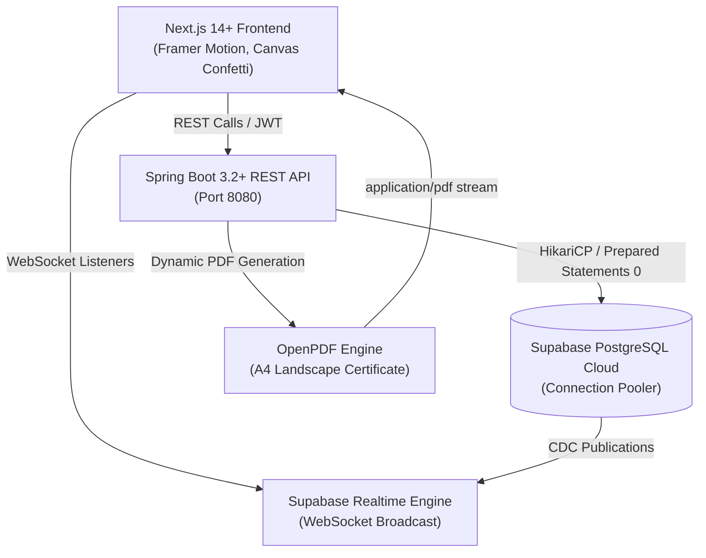

# CampusImpact: Student Club & Volunteering Hour Tracker

An enterprise-grade, production-ready full-stack application tailored for **college clubs, NSS units (National Service Scheme), IEDC (Innovation & Entrepreneurship Development Centres), and campus social drives**. 

Built with a **Java Spring Boot 3.x** backend connected to **Supabase (PostgreSQL)**, and an animated **Next.js 14+ (App Router, TypeScript, Tailwind CSS, Framer Motion)** frontend featuring **topic-matched, content-driven animations**.

---

## 🏛️ System Architecture



---

## 📁 Project Directory Structure

```
d:/appu/
├── backend/
│   ├── pom.xml                                      # Maven config with Spring Boot 3.2, OpenPDF, JJWT
│   └── src/
│       └── main/
│           ├── resources/
│           │   ├── application.properties           # HikariCP pooler tuning, Supabase config, JWT secrets
│           │   └── schema.sql                       # Complete PostgreSQL schema, constraints, realtime & seed data
│           └── java/com/campus/volunteering/
│               ├── VolunteeringTrackerApplication.java
│               ├── model/
│               │   ├── Role.java                    # STUDENT, COORDINATOR, ADMIN
│               │   ├── ClubCategory.java            # NSS_COMMUNITY, ENVIRONMENT_ECO, HEALTH_WELFARE, TECH_SOCIAL
│               │   ├── AttendanceStatus.java        # REGISTERED, PRESENT, ABSENT
│               │   ├── User.java                    # User JPA entity
│               │   ├── ClubOrUnit.java              # Club / Unit JPA entity
│               │   ├── ActivityEvent.java           # Activity drive JPA entity
│               │   └── AttendanceLog.java           # Attendance log entity with UNIQUE(student_id, event_id)
│               ├── repository/
│               │   ├── UserRepository.java
│               │   ├── ClubOrUnitRepository.java
│               │   ├── ActivityEventRepository.java
│               │   └── AttendanceLogRepository.java
│               ├── dto/
│               │   ├── AuthRequest.java
│               │   ├── RegisterRequest.java
│               │   ├── AuthResponse.java
│               │   ├── EventCreateRequest.java
│               │   ├── StudentDashboardDTO.java
│               │   ├── LeaderboardDTO.java
│               │   └── AttendanceVerifyRequest.java
│               ├── security/
│               │   ├── JwtUtils.java                # JJWT 0.12.5 stateless token engine
│               │   ├── UserDetailsImpl.java
│               │   ├── UserDetailsServiceImpl.java
│               │   ├── AuthTokenFilter.java
│               │   ├── AuthEntryPointJwt.java
│               │   └── SecurityConfig.java          # CORS & SecurityFilterChain
│               ├── exception/
│               │   ├── DuplicateRegistrationException.java # 409 Conflict
│               │   ├── EventFullException.java            # 400 Bad Request
│               │   ├── InsufficientHoursException.java    # 403 Forbidden
│               │   ├── ResourceNotFoundException.java     # 404 Not Found
│               │   └── GlobalExceptionHandler.java        # Centralized REST advice
│               ├── service/
│               │   ├── EventService.java            # Atomic student registration
│               │   ├── AttendanceService.java       # Idempotent verification & batch stamping
│               │   ├── CertificateService.java      # Dynamic OpenPDF landscape certificate
│               │   ├── StudentService.java          # Milestones & statistics
│               │   └── LeaderboardService.java      # Department aggregation & ranks
│               └── controller/
│                   ├── AuthController.java
│                   ├── EventController.java
│                   ├── AttendanceController.java
│                   ├── StudentController.java
│                   ├── LeaderboardController.java
│                   └── CertificateController.java
│
└── frontend/
    ├── package.json                                 # Next.js 14, Framer Motion, canvas-confetti, lucide-react
    ├── tsconfig.json
    ├── tailwind.config.ts                           # Deep slate-navy (#0B1120), parchment, emerald & gold theme
    ├── postcss.config.js
    ├── next.config.js
    └── src/
        ├── types/index.ts                           # TypeScript models
        ├── lib/
        │   ├── utils.ts                             # Styling & formatting helpers
        │   ├── supabase.ts                          # Supabase Client & Realtime configuration
        │   └── api.ts                               # Spring Boot API Client + Interactive Demo Fallback
        ├── components/
        │   ├── Navbar.tsx                           # Brand header, active persona switcher, certificate button
        │   ├── LivingImpactTree.tsx                 # 4-stage SVG growth tree, 60h radial gauge, evaluator slider
        │   ├── CampusPassCard.tsx                   # Perforated ticket-stub pass, category micro-animations
        │   ├── CoordinatorLedger.tsx                # Official Ledger, physical rubber stamp, domino cascade
        │   ├── CertificateModal.tsx                 # Wax-seal breaking, confetti, unfurling parchment, live SVG ink
        │   └── Leaderboard.tsx                      # LayoutGroup gliding ranks & custom tier shields
        └── app/
            ├── globals.css
            ├── layout.tsx
            └── page.tsx                             # Unified interactive main application hub
```

---

## 🎨 Topic-Matched Creative Motion Design Features

### 1. The Living Impact Tree & Service-Hour Sunburst (Student Hub)
- **Interactive SVG Tree**: Uses Framer Motion `motion.path` with dynamic `pathLength`, `scale`, and `opacity`.
- **Stage 1 (0–15h "Seedling Volunteer")**: Sprouting stem with 2 gently swaying emerald leaves (`rotate: [-3, 3, -3]`).
- **Stage 2 (15–30h "Active Sapling")**: Trunk thickens, secondary branches draw outward with spring physics and 8 leaves.
- **Stage 3 (30–59h "Canopy Builder")**: Dense, multi-layered emerald foliage canopy bloomed across branches.
- **Stage 4 (60+h "NSS Gold Scholar")**: Golden fruit/honour badges bloom on branches with floating golden pollen particles.
- **Evaluator Simulation Slider**: A slider (0 to 80 hrs) and quick-switch buttons let evaluators observe the tree grow and bloom in real time!

### 2. Perforated Campus Pass Event Cards (Events Radar)
- **Official Perforated Ticket**: Separated by a dashed vertical tear-line (`border-l-2 border-dashed`).
- **Category Micro-Animations**:
  - `ENVIRONMENT_ECO`: Animated floating leaf SVG drifting softly in header + emerald liquid capacity bar.
  - `HEALTH_WELFARE`: Rhythmic double-beat pulse animation (`scale: [1, 1.15, 1, 1.08, 1]`) on the medical cross/heart icon.
  - `NSS_COMMUNITY`: Concentric radar beacon ripples radiating from the location badge.
  - `TECH_SOCIAL`: Subtle circuit-node pulse line in header.
- **Ticket-Stub Registration Animation**: Clicking "Claim Volunteer Pass" tilts the stub (`rotate: 2.5deg, x: 4px`), slams down a textured emerald "REGISTERED ✓" stamp, and smoothly fills the volunteer capacity bar.

### 3. Coordinator's Official Rubber-Stamp & Ink Ledger (Coordinator Desk)
- **Physical Rubber-Stamp Slam**: Rapid downward physical stamp motion (`scale: [2.2, 0.88, 1.05, 1]`, `rotate: [-12, -5]`) with stiff spring physics (`stiffness: 500, damping: 18`).
- **Ink Splatter Shockwave Ripple**: Expanding circular shockwave from the stamp button across the row.
- **Glowing Hour-Token**: Arcs upward from the row and adds into the student's cumulative hours.
- **Staggered Domino Batch Stamp**: Clicking "Stamp All Present" triggers a rapid 0.08s staggered sequence of stamps slamming down the entire roster.

### 4. Academic Wax-Seal & Unfurling Scroll Modal (Certificate Vault)
- **Locked State (<60 hrs)**: Rolled parchment inside frosted glass sleeve locked by a 3D embossed Crimson & Gold Wax Seal with an hour progress ring.
- **Unlocked State (60+ hrs)**: "Break Wax Seal & Claim Certificate" fractures the seal, triggers a golden/emerald `canvas-confetti` salute, and unfurls the parchment scroll (`scaleY: [0.1, 1]`).
- **3D Perspective Mouse Tilt**: Certificate tilts interactively in 3D space following cursor position.
- **Live Fountain-Pen SVG Signatures**: Faculty Coordinator and Principal signatures draw themselves in real time (`pathLength: 0 -> 1`).
- **OpenPDF Backend Download**: Downloads an official A4 landscape PDF generated by Spring Boot with double ornate navy and gold borders, corner diamonds, academic emblems, student details, hours citation, signatures, and unique verification code (`CERT-NSS-2026-[ROLL_NO]-[HASH]`).

### 5. Service Shield Leaderboard with Live Layout Gliding
- Department-wise tabs (`CSBS`, `CSE`, `ECE`, `ME`, `ALL`).
- Custom SVG Service Tier Shields (`Bronze Sapling`, `Silver Torchbearer`, `Gold NSS Scholar`).
- Wrapped in Framer Motion `<LayoutGroup>` with `layout` props so that whenever hours are verified, students physically glide upward past other rows to their new rank!

---

## 🚀 How to Run the Application

### 1. Database Setup (Supabase Cloud PostgreSQL)
1. Open your Supabase Project Dashboard and navigate to the **SQL Editor**.
2. Paste the complete script from [schema.sql](file:///d:/appu/backend/src/main/resources/schema.sql) and execute it.
3. This creates all tables, indexes, constraints, enables Supabase Realtime, and populates realistic seed data.

### 2. Spring Boot Backend
1. Open a terminal in `d:/appu/backend`.
2. Configure your environment variables or update [application.properties](file:///d:/appu/backend/src/main/resources/application.properties):
   ```bash
   export SPRING_DATASOURCE_URL="jdbc:postgresql://<SUPABASE_HOST>:5432/postgres?sslmode=require&prepareThreshold=0"
   export SUPABASE_DB_USER="postgres.<PROJECT_REF>"
   export SUPABASE_DB_PASSWORD="<YOUR_PASSWORD>"
   ```
3. Run the Spring Boot application:
   ```bash
   mvn spring-boot:run
   ```
   Backend starts on `http://localhost:8080`.

### 3. Next.js Frontend
1. Open a terminal in `d:/appu/frontend`.
2. Install dependencies:
   ```bash
   npm install
   ```
3. Run the development server:
   ```bash
   npm run dev
   ```
4. Open [http://localhost:3000](http://localhost:3000) in your browser.
5. The frontend has complete offline/interactive demo fallback support: you can immediately explore and test all animations, simulator sliders, ticket stamps, domino batch verify, and wax-seal breaking right out of the box!
